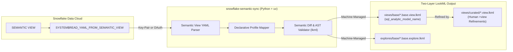

# Looker Snowflake Semantic Sync

Programmatic CLI that extracts Snowflake Semantic Views via `SHOW SEMANTIC VIEWS` and `SYSTEM$READ_YAML_FROM_SEMANTIC_VIEW` and synchronizes them into Looker In-Database Analytic Model LookML (`sql_analytic_model_name`).

## Architecture



### Key Features

1. **Self-Contained Metadata Extraction**: Queries `SHOW SEMANTIC VIEWS IN SCHEMA <db>.<schema>` and `SELECT SYSTEM$READ_YAML_FROM_SEMANTIC_VIEW('<db>.<schema>.<view>')` to extract logical tables, dimensions, time dimensions, metrics, descriptions, synonyms, sample values, and compiler-inferred data types while excluding `private_access` / `PRIVATE` fields.
2. **Looker `sql_analytic_model_name` Generation**:
   - Emits fully-qualified `sql_analytic_model_name: <DATABASE>.<SCHEMA>.<SEMANTIC_VIEW> ;;` definitions so views resolve reliably regardless of the Looker connection's default schema.
   - Enforces Looker's analytic model field type constraints (`string`, `number`, `date`, `date_time`, `datetime`, `yesno`, and `dimension_group` `type: time`) — emitting `dimension_group` for `DATE` and `TIMESTAMP*` dimensions (`convert_tz: no` on `DATE` and `TIMESTAMP_NTZ`) and `type: string` for `TIME` columns.
   - Organizes multi-table Semantic View dimensions and metrics using `group_label` per logical entity, disambiguates colliding LookML field names, and qualifies colliding SQL references with 3-part `${TABLE}.<LOGICAL_TABLE>.<FIELD>` syntax.
3. **Two-Layer Refinement Architecture**:
   - **Machine-Managed Base Layer**: `views/base/*.base.view.lkml` and `explores/base/*.base.explore.lkml` are updated on every sync and validated via `lkml` AST round-tripping.
   - **Human-Owned Curated Layer**: `views/curated/*.view.lkml` (`view: +<name>`) and `models/*.model.lkml` are scaffolded once via `--scaffold` and are never overwritten or included in automated GitHub Pull Requests.
   - Curated refinements support label, description, `value_format_name`, and `drill_fields` overrides, derived `type: number` measures referencing base measures (compiled to `AGG(...)`), and same-entity derived dimensions.
4. **Flexible Snowflake Authentication**:
   - `key_pair`: RSA 2048-bit PKCS#8 private key (`.p8` / `.pem` file path, raw PEM string, or base64-encoded PEM string, with optional passphrase).
   - `oauth`: Direct OAuth 2.0 Bearer access token.
   - `oauth_client_credentials`: Automated OAuth 2.0 Client Credentials token exchange over HTTPS.
   - `externalbrowser`: Interactive browser SSO/OAuth for local desktop environments with token caching.
5. **Looker Dev Deployment & Deduplicated GitHub PRs**:
   - Optional `--deploy` pushes machine-managed base files to a Looker dev workspace and runs LookML project validation via Looker SDK or `looker-cli` (`--looker-profile`).
   - Optional `--pr` creates or updates a single deduplicated Pull Request strictly scoped to `views/base/` and `explores/base/`, bootstrapping empty repositories cleanly and skipping redundant pushes when an open PR is already up to date.

## Prerequisites

- Python 3.11+ and [`uv`](https://docs.astral.sh/uv/)
- Snowflake account with one or more `SEMANTIC VIEW` objects and Key-Pair or OAuth access
- Looker instance with `sql_analytic_model_name` support (and `looker-cli` or Looker SDK API credentials if using `--deploy` / `validate`)
- GitHub Personal Access Token (`GITHUB_TOKEN`, `GITHUB_PAT`, or `GITHUB_PERSONAL_ACCESS_TOKEN`) if using `--pr`

## Installation

```bash
uv sync --all-extras
```

## Configuration

Copy `.env.example` to `.env` and populate your Snowflake, Looker, and optional GitHub credentials:

```bash
cp .env.example .env
```

Adjust declarative sync settings in `config/sync_config.yaml` and mapping behavior (identifier qualification, `dimension_group` timeframes, value format rules) in `config/profiles/default_analytic_model.yaml`.

## Usage

### 1. List Snowflake Semantic Views

```bash
uv run snowflake-semantic-sync list-views
```

### 2. Generate LookML Locally

```bash
# Sync all Semantic Views in the configured schema and scaffold starter curated refinements + model
uv run snowflake-semantic-sync sync --scaffold

# Sync specific Semantic View(s)
uv run snowflake-semantic-sync sync -v TPCH_REV_ANALYSIS
```

### 3. Deploy to Looker Dev Workspace & Validate

```bash
# Deploy machine-managed base files using a looker-cli profile and run LookML validation
uv run snowflake-semantic-sync sync -v TPCH_REV_ANALYSIS --deploy --looker-profile <your-profile>

# Optionally checkout a specific Looker dev branch before deploying
uv run snowflake-semantic-sync sync --deploy --looker-profile <your-profile> --looker-branch <dev-branch>

# Validate an existing Looker project directly
uv run snowflake-semantic-sync validate --project <project-id> --looker-profile <your-profile>
```

### 4. Open or Update a GitHub Pull Request

```bash
uv run snowflake-semantic-sync sync --pr --git-repo <owner>/<repo>
```

### 5. Offline Preview from Exported Semantic View YAML

To preview LookML generation offline from a YAML file exported via `SELECT SYSTEM$READ_YAML_FROM_SEMANTIC_VIEW(...)`:

```bash
uv run snowflake-semantic-sync sync \
  --from-yaml tests/fixtures/sample_semantic_view.yaml \
  --database ANALYTICS_DB \
  --schema GOLD \
  --scaffold
```

## Testing

```bash
uv run pytest -v
```
